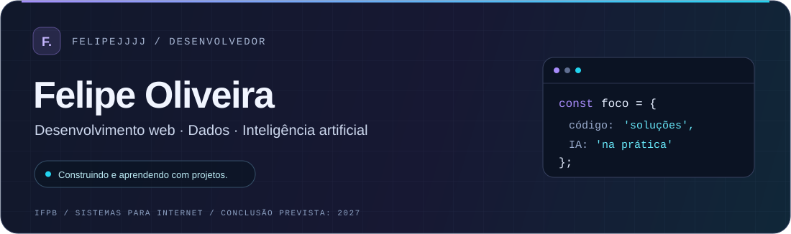
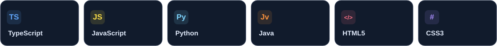
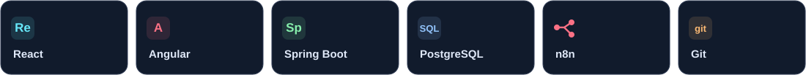
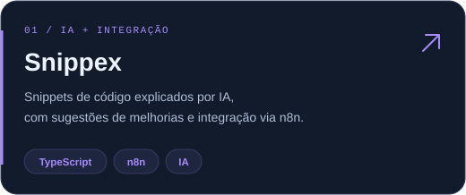
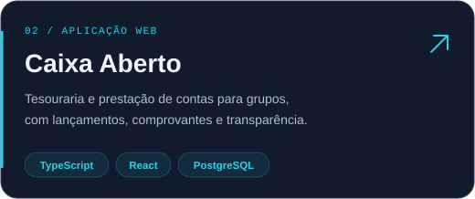
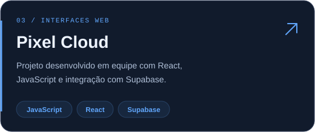
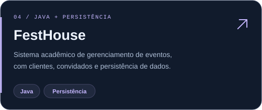

 

### Olá! Sou Felipe Oliveira Raimundo.

Estudante de **Sistemas para Internet no IFPB — Campus João Pessoa**, com conclusão prevista para **2027**, e técnico em Informática pelo IFPB.

Desenvolvo projetos web, tenho afinidade com bancos de dados e utilizo **inteligência artificial** como apoio à construção e evolução das minhas soluções. Gosto de aprender na prática e construir em equipe.

 

### Linguagens que utilizo

### Ferramentas e integrações

 

### Projetos em destaque

<table>
  <tr>
    <td width="50%"></td>
    <td width="50%"></td>
  </tr>
  <tr>
    <td width="50%"></td>
    <td width="50%"></td>
  </tr>
</table>

 

### Código, dados e IA na prática

No **Snippex**, participei do desenvolvimento em grupo de uma aplicação que armazena trechos de código. A IA, integrada por meio do **n8n**, explica o funcionamento desses trechos e sugere melhorias.

Também tenho experiência acadêmica com **modelagem relacional** e com um projeto web integrado a banco de dados, desenvolvido inicialmente em **TypeScript** e posteriormente remodelado para **Spring Boot**.

 

